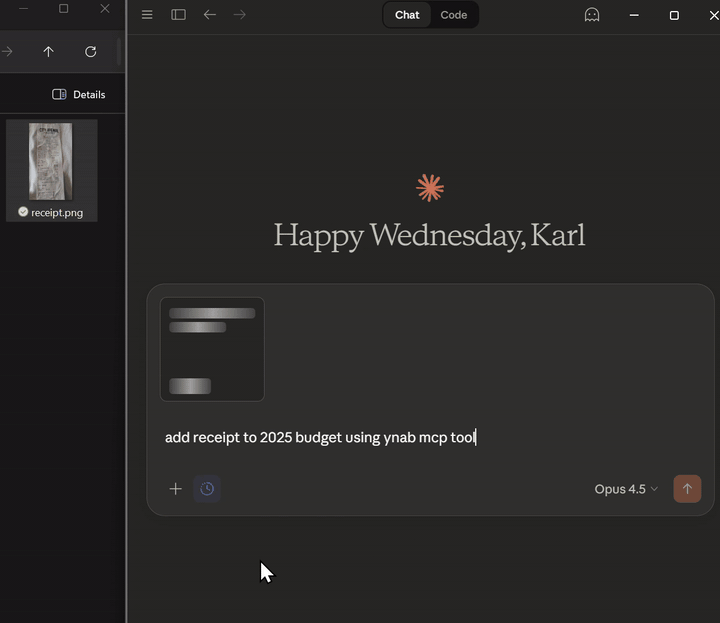

<div align="center">

# YNAB MCP Server

**Talk to your YNAB budget from Claude, Codex, Cline or any MCP client.**

[](https://github.com/dizzlkheinz/ynab-mcpb/releases/latest)
[](https://www.npmjs.com/package/@dizzlkheinz/ynab-mcpb)
[](LICENSE.MD)
[](https://nodejs.org)



<sub>Paste a receipt → itemized split transaction with tax allocated</sub>

</div>

## What it does

A local server that gives an AI assistant safe, structured access to your YNAB budget.
**35 YNAB tools** cover budgets, accounts, transactions, categories, payees, months and
scheduled transactions, plus a few workflows YNAB itself doesn't have:

- **Receipt splitting.** Paste or photograph a receipt; get one split transaction with each
  item in its category and the tax distributed exactly to the cent.
- **Bank reconciliation.** Give it a bank CSV; it matches against YNAB (fuzzy payee, date
  tolerance, exact amounts), shows what's missing or mismatched, and applies the fixes you
  approve.
- **Spending analysis.** Deterministic totals by category or payee for any period, and
  period-over-period comparisons.
- **Bulk cleanup.** Create or update up to 100 transactions at once, including turning a
  transaction into a split.

Every write is **previewed first** by default: the assistant sees exactly what will change
and must repeat the identical request with a short-lived, single-use token to apply it.

```text
"Split this receipt across groceries and household, with tax."
"Reconcile my checking account against this CSV."
"What did I spend on takeout this month compared to last month?"
"What scheduled bills are due before the 30th?"
"Categorize my uncategorized transactions from last week."
```

## Setup

**1. Get a YNAB token.** In YNAB go to
[Account Settings → Developer Settings](https://app.ynab.com/settings/developer) →
**New Token**, and copy it (it is shown once).

**2. Install.**

<details open>
<summary><strong>Claude Desktop (MCPB bundle)</strong></summary>

1. Download the latest `.mcpb` from [Releases](https://github.com/dizzlkheinz/ynab-mcpb/releases/latest).
2. Open it with Claude Desktop (or drag it into **Settings → Extensions**).
3. Paste your token when prompted.

</details>

<details>
<summary><strong>Any MCP client via npx (Claude Desktop, Cline, Cursor, ...)</strong></summary>

```json
{
  "mcpServers": {
    "ynab": {
      "command": "npx",
      "args": ["-y", "@dizzlkheinz/ynab-mcpb@latest"],
      "env": { "YNAB_ACCESS_TOKEN": "your-token" }
    }
  }
}
```

</details>

<details>
<summary><strong>Codex</strong></summary>

```toml
[mcp_servers.ynab]
command = "npx"
args = ["-y", "@dizzlkheinz/ynab-mcpb@latest"]
env = { "YNAB_ACCESS_TOKEN" = "your-token" }
startup_timeout_sec = 120
```

</details>

<details>
<summary><strong>Claude Code</strong></summary>

```bash
claude mcp add ynab --env YNAB_ACCESS_TOKEN=your-token -- npx -y @dizzlkheinz/ynab-mcpb@latest
```

</details>

**3. Try it:** *"List my budgets and make my main one the default."*

## Configuration

Everything except the token is optional.

| Variable | Default | |
|---|---|---|
| `YNAB_ACCESS_TOKEN` | — | Required. Your personal access token. |
| `YNAB_DEFAULT_BUDGET_ID` | — | Budget used when a tool call omits `budget_id` (the UUID in your YNAB URL). Can also be set in chat with `ynab_set_default_budget`. |
| `YNAB_MCP_WRITE_MODE` | `preview` | `preview`: every write needs a confirmation token from a preview. `enabled`: writes apply directly. `read-only`: no write tools at all. |
| `YNAB_MCP_TOOL_PROFILE` | `full` | `core` exposes a smaller set of common tools to save context. |
| `YNAB_EXPORT_PATH` | Downloads (Linux: Documents) | Where `ynab_export_transactions` writes files. |
| `LOG_LEVEL` | `info` | `trace`, `debug`, `info`, `warn`, `error`. Logs go to stderr. |

## Privacy

- The server runs on your machine and talks only to the YNAB API.
- Whatever a tool returns becomes part of your conversation, so it is processed by the AI
  provider your client uses.
- Exports stay on local disk.
- Keep your token in your client's config. Never paste it into a chat, issue or log.
- This is an independent project, not affiliated with or endorsed by YNAB.

## Troubleshooting

| Problem | Fix |
|---|---|
| `npx` fails or the server won't start | Install Node.js 24+, then restart your client. |
| 401 / unauthorized | Generate a new token and update `YNAB_ACCESS_TOKEN`. |
| Tools don't appear | Restart the client after changing its config. |
| 429 / rate limited | YNAB allows 200 requests per hour per token; wait and retry. |
| A reconciliation looks wrong | [Open an issue](https://github.com/dizzlkheinz/ynab-mcpb/issues) with an anonymized CSV sample. |

## Documentation

- [Tool reference](docs/reference/API.md): every tool, prompt and resource
- [Reconciliation design](docs/technical/reconciliation-system-architecture.md)
- [Receipt splitting spec](docs/technical/receipt-itemization-spec.md)
- [Contributing and architecture](AGENTS.md)
- [Changelog](CHANGELOG.md)

## Development

```bash
git clone https://github.com/dizzlkheinz/ynab-mcpb.git && cd ynab-mcpb
npm ci --ignore-scripts
npm run build
npm test && npm run test:integration   # offline; no token needed
```

To run it against your budget, copy `.env.example` to `.env`, add your token and run
`npm start`. See [AGENTS.md](AGENTS.md) for architecture, conventions and the full command list.
Bug reports and PRs are welcome.

## License

[AGPL-3.0](LICENSE.MD)
