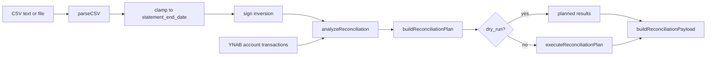

# Reconciliation Architecture

`ynab_reconcile_account` matches a bank CSV against one YNAB account, reports discrepancies, and can apply bulk create/update/unclear/reconcile operations. Code lives in `src/tools/reconciliation/`; the tool is registered in `index.ts`.

All amounts are integer milliunits internally. Only `csvParser.ts` converts bank decimals to milliunits.

## Pipeline



`handleReconcileAccount` (`index.ts`):

1. Resolve the budget, find the account (error if absent), read the budget currency (`iso_code`, `decimal_digits`; defaults `USD`, 2).
2. Load CSV from `csv_data` or `csv_file_path` (path candidates for sandbox/WSL forms are tried; empty content is an error).
3. Parse, then drop CSV rows after `statement_end_date`.
4. Fetch the full account transaction list, resolve sign inversion, negate bank amounts if needed.
5. Analyze, build the plan from a frozen deep copy of the analysis, render the result.

## CSV parsing (`csvParser.ts`)

- Papaparse with a 10 MB size cap and 10,000 row cap (`maxBytes`, `maxRows`). Delimiters are restricted to `,` `;` tab `|` space.
- Format resolution order: explicit `csv_format` fields, then a preset (detected from the first row), then defaults. A first row containing "date" is treated as a header; a headerless TD-style layout (`Date, Description, Debit, Credit[, Balance]` with `MM/DD/YYYY` dates) is detected as `td`.
- `csv_format` accepts `date_column`, `amount_column`, `debit_column`, `credit_column`, `description_column`, `date_format`, `has_header`, `delimiter`. Columns may be names or indexes. `date_format` maps to a hint of `YMD`, `MDY` or `DMY`.
- Dates: the hint is applied first, then `chrono-node` as a fallback. Output dates are `YYYY-MM-DD`.
- Rows that fail to parse produce errors; any error makes the tool fail with the row numbers. Non-fatal issues become warnings (for example both debit and credit populated, where debit is used).

Bank presets (`BANK_PRESETS`): `td` (headerless by default, `MDY`), `rbc` (`Debit`/`Credit` columns, `YMD`), `scotiabank` (`DMY`), `wealthsimple` (`YMD`), `tangerine` (`MDY`). Presets are auto-detected from known headers, and `td` also from the headerless row pattern.

## Sign detection (`signDetector.ts`)

`sign_convention`: `invert` and `as_is` are explicit. `auto` (default):

- Default assumption: invert for liability account types (`creditCard`, `lineOfCredit`, `mortgage`, `autoLoan`, `studentLoan`, `personalLoan`, `medicalDebt`, `otherDebt`, `otherLiability`), otherwise do not.
- `detectSignInversion` samples up to 50 bank rows evenly, pairs each with the closest YNAB transaction (absolute amounts within 100 milliunits, dates within 7 days; score is 70% amount, 30% date), and returns true when more than half of the pairs have opposite signs. With no pairs it returns null and the account-type default stands.

`statement_balance` is used as given (liability balances are normally negative).

## Statement window

- `statement_end_date` must be a `YYYY-MM-DD` date (surrounding whitespace ignored; empty is treated as omitted). Other formats fail validation.
- If given, CSV rows after it are removed (`statementWindow.ts`); if none remain the tool errors. If omitted, the latest CSV transaction date is used as the effective end date and a note says so.
- YNAB transactions are matched only when dated within `[earliest CSV date - date_tolerance_days, effective end date]` (or `latest CSV date + tolerance` when no end date applies). Others are counted as outside the range and never reported as missing from the bank.
- Balance snapshots use the effective end date: YNAB transactions dated on or before it.

## Matching (`matcher.ts`)

Each bank row is scored against unused YNAB transactions in order, so earlier bank rows claim YNAB rows first.

Candidate filter:

- Same sign (zero matches either).
- Amount identical in milliunits (the tool never sets `amountTolerance`).
- Date difference at most `date_tolerance_days` (default 7, range 0-7).

Score, with `BASE_SCORE = 50`:

```
combined = 50 + dateScore * 0.15 + payeeScore * 0.35
         + 5  if dateScore == 100
         + 10 if payeeScore >= 95
capped at 100, rounded
```

- `dateScore`: under 0.5 day 100; up to 1 day 95; up to tolerance `90 - (days - 1) * 40 / tolerance`.
- `payeeScore`: highest of fuzzball `token_set_ratio`, `token_sort_ratio`, `partial_ratio`, `WRatio` between the bank payee and the YNAB payee, and also against the YNAB memo; 30 if the YNAB transaction has no payee.
- Candidates below 40 (`minimumCandidateScore`) are dropped. Sort: combined score, then uncleared first, then closest date. Top 3 are kept.

Confidence (`match_strictness`):

| Strictness | high (auto-match) | medium (suggested) |
|------------|------|------|
| loose | 70 | 55 |
| normal (default) | 85 | 60 |
| strict | 93 | 75 |

Below the suggested threshold but at least 40 is `low`; below 40 is `none`. Exception: when the best candidate is the only candidate and has an exact-date score (100), a score of at least 65 (`exactDateAutoMatchThreshold`) is `high` regardless of strictness. A `high` match consumes its YNAB transaction.

`analyzer.ts` buckets results: `high` becomes `auto_matches`; `medium` becomes `suggested_matches` (unless its YNAB transaction was auto-matched); every other bank row is `unmatched_bank`. In-range YNAB rows with no match are `unmatched_ynab`, excluding the system payees "Starting Balance", "Manual Balance Adjustment" and "Reconciliation Balance Adjustment". The analyzer also emits insights (repeat amounts, anomalies, CSV warnings). `recommendationEngine.ts` builds action recommendations (create, update cleared, review duplicate) onto `analysis.recommendations`; they are not part of the tool response.

## Balances

- `analysis.balance_info` compares the account's current cleared balance to `statement_balance`; `on_track` means a difference under 10 milliunits.
- After a real run with a statement date, `buildBalanceReconciliation` re-reads the account and sums non-deleted `cleared` and `reconciled` transactions dated on or before the statement date. `discrepancy = statement - ynab`; status is `balanced` only when zero. For a dry run the same calculation uses the plan's projected cleared balance.
- If the discrepancy is a multiple of 500 milliunits, a single `bank_fee` likely cause (confidence 0.8) is attached. `all_transactions_accounted`, `audit_trail_complete` and `reconciliation_complete` are always false: a matching balance does not prove completeness.

## Plan and execution

`buildReconciliationPlan` (`plan.ts`) is pure. It turns the analysis and flags into ordered `PlannedOperation`s, each with an exact payload, and computes the projected cleared balance. Order:

1. `create` for each `unmatched_bank` row (`auto_create_transactions`): cleared, approved, memo truncated, newest first.
2. `update` for each auto-match: set `cleared` if the YNAB row is uncleared (`auto_update_cleared_status`), set the bank date if different (`auto_adjust_dates`).
3. `unclear` (`auto_unclear_missing`): cleared `unmatched_ynab` rows dated on or before the statement end date, newest first, only while the projected cleared balance is more than 10 milliunits from the statement balance.
4. `reconcile` (`auto_update_cleared_status`): only if the projected cleared balance equals the statement balance exactly; marks the matched cleared transactions `reconciled`.

The plan also stores a SHA-256 fingerprint of the account's non-deleted transactions and the account balance snapshot.

`executeReconciliationPlan` (`executor.ts`) writes only the plan's payloads; it never re-reads the CSV or re-runs matching.

- Before any write (not on dry runs) it re-fetches the account's transactions and recomputes the fingerprint. A mismatch throws "Account transactions changed since preview. No changes were applied. Preview reconciliation again."
- Contiguous operations of the same kind are sent in chunks of 100 (create via `createTransaction`/`createTransactions`, the rest via `updateTransactions`).
- Each operation must be acknowledged by a returned transaction whose fields equal the payload. A thrown error, or an operation YNAB did not acknowledge, marks it `uncertain`, records an error ("Check YNAB before retrying"), and stops the run: all later operations are `skipped`. There are no retries and no per-row fallback.
- Operation statuses: `planned` (dry run), `applied`, `uncertain`, `skipped`. If final balance verification fails after writes, the error says the writes are recorded and to check YNAB.
- Progress notifications (`sendProgress`) are advisory and never repeat a write.

## Write safety

The tool is registered with `writeSafety: { mutation: true, preview: "dry-run", prepared: true }`. `dry_run` defaults to true.

- `YNAB_MCP_WRITE_MODE=read-only`: mutating tools are hidden.
- `preview` (default): a call without `confirmation_token` always runs as a dry run, captures the plan and its execution, and returns a single-use `confirmation_token` and `confirmation_expires_at` (also in `structuredContent`). Calling again with the same request plus the token runs the captured execution, which is the previewed operations and nothing recomputed, subject to the fingerprint check. Preview fails if the handler captured no execution.
- `enabled`: `dry_run: false` writes directly; the plan is built and executed within the same call.

## Output

One payload (`outputBuilder.ts`), validated by `ReconcileAccountOutputSchema` in `schemas/outputs/reconciliationOutputs.ts`:

```
{
  human: string,        // report: header, notes, balance, analysis, insights, execution, next steps
  structured: {
    unmatched_bank, unmatched_ynab,   // each with amount_money
    suggestions,                      // medium-confidence matches with up to 3 candidates
    execution_summary?, operations?, errors?   // present when an execution result exists
  }
}
```

`execution_summary` has `transactions_created`, `transactions_updated`, `dates_adjusted`, `dry_run`, `balance_status` (`balanced`, `unbalanced` or `not_verified`) and `recommendations`. `operations` lists every planned operation with its status. The result is marked `isError` when `errors` is non-empty. `max_suggestions_in_output` (default 20) limits what the human report shows.
